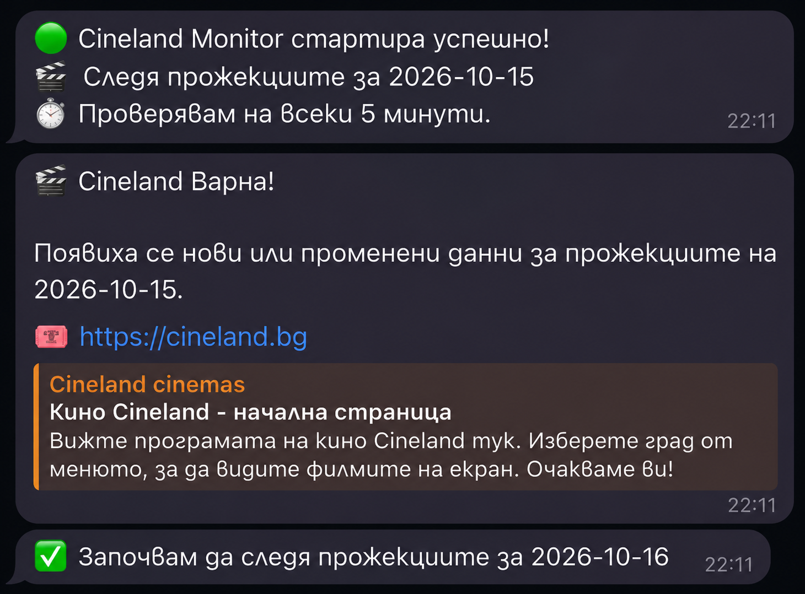

# Cineland Telegram Bot

Java Telegram бот за автоматично следене на прожекциите в Cineland Варна.

Приложението проверява Cineland API през зададен интервал, сравнява получения JSON с предишната проверка и изпраща Telegram известие при промяна. Датата за следене може да се сменя директно от Telegram, без редакция на `.env` и без рестарт.

## Telegram Preview



## Функционалности

- Автоматично следене на прожекции в Cineland Варна.
- Периодични проверки през конфигурируем интервал.
- Смяна на датата чрез Telegram команда.
- Известия в личен Telegram чат и в група.
- Запазване на последното състояние за всяка проверявана дата.
- Сравняване на API отговорите за откриване на промени.
- Зареждане на чувствителната конфигурация от `.env`.
- Реализация с Java 17, Maven, Java HttpClient и Telegram Bot API.

## Telegram Команди

| Команда | Описание |
| --- | --- |
| `/start` | Начално съобщение от бота |
| `/help` | Показва наличните команди |
| `/status` | Показва текущата дата за следене |
| `/date YYYY-MM-DD` | Променя датата за следене |

Пример:

```text
/date 2026-10-16
```

Ботът запазва новата дата локално и я използва при следващите проверки.

## Как Работи

1. Приложението зарежда `.env` чрез `dotenv-java`.
2. Зарежда нетайните настройки от `src/main/resources/application.yml`.
3. Определя датата за следене от `cineland-selected-date.txt`, ако файлът съществува, иначе от `CHECK_DATE`.
4. Изпраща HTTP `GET` заявка към Cineland `/screening` API.
5. Ако API върне грешка, записва я в конзолата и изчаква следващата проверка.
6. Ако отговорът е празен, `[]` или `null`, не изпраща известие.
7. При непразен отговор сравнява JSON-а с последното запазено състояние за съответната дата.
8. При промяна изпраща Telegram известие и записва новото състояние.
9. Ако няма промяна, не изпраща повторно известие.

## Конфигурация

Създай `.env` в основната директория на проекта, до `pom.xml`:

```dotenv
TELEGRAM_BOT_TOKEN=your_bot_token
TELEGRAM_CHAT_ID=your_private_chat_id
TELEGRAM_GROUP_CHAT_ID=your_group_chat_id
CHECK_DATE=2026-10-16
CHECK_INTERVAL_MINUTES=5
```

`TELEGRAM_GROUP_CHAT_ID` е optional. Ако липсва, ботът изпраща известия само в личния чат.

`CHECK_DATE` трябва да е във формат `YYYY-MM-DD`.

`CHECK_INTERVAL_MINUTES` трябва да е цяло число по-голямо от `0`.

Нетайните Viber webhook настройки са в `src/main/resources/application.yml`:

```yaml
viber:
  webhook:
    domain: viber.my-expenses.xyz
    port: 8080
    path: /webhook
```

При нужда могат да се override-нат през `.env` с `VIBER_WEBHOOK_DOMAIN`, `VIBER_WEBHOOK_PORT` и `VIBER_WEBHOOK_PATH`.

## Стартиране

Бърз вариант от терминал:

```bash
cd ~/ss/projects/cineland-telegram-bot
java -version
mvn -version
mvn clean compile
mvn exec:java
```

При следващо стартиране, ако няма промени по кода:

```bash
mvn exec:java
```

Примерни логове:

```text
Selected date: 2026-10-16
Cineland Monitor started.
Checking every 5 minutes...
[2026-10-11T21:00:00] Checking Cineland...
No events available.
```

Приложението трябва да остане стартирано. Ако компютърът или Java процесът спре, автоматичните проверки също спират.

## Viber Webhook Подготовка

Приложението стартира HTTP сървър на порт `8080` и приема:

```text
POST /webhook
```

Публичният webhook адрес за Viber е:

```text
https://viber.my-expenses.xyz/webhook
```

Очакваната production схема е:

```text
viber.my-expenses.xyz -> HTTPS reverse proxy -> localhost:8080/webhook
```

Засега endpoint-ът само приема payload-а, логва го в конзолата и връща:

```json
{"status":"ok"}
```

## Cineland API

API адресът се сглобява от `application.yml`:

```text
<base-url>/<resource-type>/<resource-id>/<endpoint-path>?dateTimeFrom=<CHECK_DATE>T00:00:00.000&dateTimeTo=<CHECK_DATE+1>T23:59:59.999&movieId=<movie-id>
```


## Запазване На Състояние

Ботът пази последния получен JSON за всяка дата в отделен файл:

```text
cineland-response-2026-10-15.json
cineland-response-2026-10-16.json
```

Допълнителни runtime файлове:

```text
cineland-selected-date.txt
telegram-update-offset.txt
```

`cineland-selected-date.txt` пази последно избраната дата. `telegram-update-offset.txt` пази последната обработена Telegram актуализация, за да не се обработват стари команди повторно.

Тези файлове не трябва да се добавят в Git.

## Технологии

- Java 17
- Maven
- dotenv-java
- Jackson Databind
- Jackson YAML
- Java HttpClient
- Telegram Bot API
- Java HttpServer

## Ограничения

- Ботът следи промени в JSON отговора на API-то, не директно дали билетите са в продажба.
- Възможни са фалшиви известия, ако API-то промени несъществено поле или реда на данните.
- При празен API отговор текущата логика не актуализира предишното запазено състояние.
- За по-точно следене е нужно сравняване на конкретни прожекции по идентификатор и статус.

## Идеи За Подобрения

- Интерактивен Telegram календар с inline бутони.
- Засичане на реална наличност на билети.
- Сравняване на прожекции по уникален идентификатор.
- Известия само при новопоявили се прожекции.
- История на промените.
- Стартиране 24/7 на VPS или Raspberry Pi.

## Авторски Права

Copyright © 2026 Sunny Dineva. Всички права запазени.

Този проект и неговият изходен код са авторска собственост на Sunny Dineva. Не се разрешава копиране, разпространение, публикуване, модифициране или използване на проекта без изрично писмено разрешение от автора.

Made with Java and Telegram Bot API.
