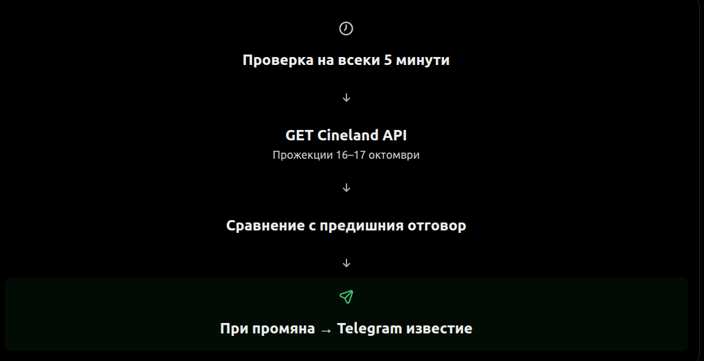
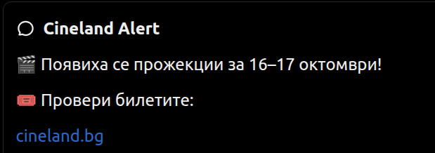

# 🎬 Cineland Telegram Bot

Java 17 приложение, което периодично проверява API-то на Cineland за прожекции на дата, зададена в `.env`, и изпраща известие в личен Telegram чат при открита промяна.

## Как работи

1. При стартиране приложението зарежда `TELEGRAM_BOT_TOKEN`, `TELEGRAM_CHAT_ID`, `CHECK_INTERVAL_MINUTES` и `CHECK_DATE` от `.env` чрез `dotenv-java`.
2. Изпраща HTTP `GET` заявка към Cineland API веднага, след което повтаря проверката през зададения интервал след приключване на предишната проверка.
3. Ако отговорът не е HTTP 200, записва грешка в конзолата и изчаква следващата проверка.
4. Ако отговорът е празен, `[]` или `null`, не изпраща известие.
5. При непразен отговор сравнява получения текст с последно записания в `cineland-response.json`.
6. Ако има разлика, изпраща Telegram съобщение чрез Telegram Bot API (`sendMessage`). След успешното изпращане записва новия отговор във файла.
7. Ако няма разлика, не изпраща повторно известие.


```text
Стартиране
    │
    ▼
Зареждане на .env
    │
    ▼
GET към Cineland API ◄───────────┐
    │                             │
    ▼                             │
HTTP 200 и непразен отговор?      │
    │                             │
    ├─ Не ────────────────────────┤
    │                             │
    ▼                             │
Сравнение с локалния файл         │
    │                             │
    ├─ Без промяна ───────────────┤
    │                             │
    ▼                             │
Изпращане на Telegram съобщение   │
    │                             │
    ▼                             │
Запис на новото състояние         │
    │                             │
    └── Изчакване според .env ────┘
```

## Изисквания

- Java 17 или по-нова
- Maven
- Telegram бот, създаден чрез [@BotFather](https://t.me/BotFather)
- Telegram `chat_id` на чата, в който ботът има право да изпраща съобщения; първо натисни **Start** в чата с бота

## Структура на проекта

```text
cineland-telegram-bot/
├── .env                         # локални тайни, не се качват в Git
├── .gitignore
├── pom.xml
├── cineland-response.json       # създава се автоматично при успешно известие
└── src/
    └── main/
        └── java/
            └── org/
                └── sunny/
                    └── CinelandMonitor.java
```

## Настройка

Създай `.env` до `pom.xml`:

```dotenv
TELEGRAM_BOT_TOKEN=your_bot_token
TELEGRAM_CHAT_ID=your_chat_id
CHECK_INTERVAL_MINUTES=5
CHECK_DATE=2026-10-16
```

`CHECK_INTERVAL_MINUTES` трябва да е цяло число по-голямо от 0. Ако липсва, приложението използва 5 минути.
`CHECK_DATE` трябва да е във формат `YYYY-MM-DD`. Ако липсва, приложението използва `2026-10-16`.

Добави в `.gitignore`:

```gitignore
.env
cineland-response.json
target/
```

Не публикувай токена на бота. Файлът `.env` се зарежда от текущата работна директория, затова стартирай командите от корена на проекта.

## Стартиране

Бърз вариант от терминал:

```bash
cd ~/ss/projects/cineland-telegram-bot
java -version
mvn -version
mvn clean compile
mvn exec:java
```

За следващо пускане, когато няма промени по кода, е достатъчно:

```bash
mvn exec:java
```

В `pom.xml` трябва да е конфигуриран `exec-maven-plugin` с `mainClass` = `org.sunny.CinelandMonitor`, както и зависимостта `io.github.cdimascio:dotenv-java`.

Примерни логове:

```text
Cineland Monitor started.
Checking every 5 minutes...
[2026-10-11T21:00:00] Checking Cineland...
No events available.
```

Приложението трябва да остане стартирано. Ако компютърът или процесът спре, проверките също спират.

## Следен API адрес

```text
https://restapi.cineland.bg/api/cinema/0ad469dc-cd3d-4a21-bfed-d7757fe3354d/event?dateTimeFrom=<CHECK_DATE>T00:00:00.000&dateTimeTo=<CHECK_DATE>T23:59:59.999
```

Датата се задава с `CHECK_DATE` в `.env`.

## Важни ограничения

- **Не се проверява директно дали билети могат да бъдат купени.** Текущата реализация открива промени в текстовия JSON отговор на API-то.
- **Възможни са фалшиви известия**, ако API-то промени несъществено поле или реда на данните.
- При **първия непразен отговор** се изпраща известие, тъй като все още няма записано предишно състояние.
- Празен отговор **не изтрива** предишното записано състояние.
- За надеждно следене на нови прожекции и реална продажба на билети трябва да се анализира структурата на API JSON и да се сравняват конкретни полета.
- Ако Telegram изпращането се провали, новото състояние не се записва и приложението ще опита отново при следващата проверка.

## Идеи за подобрения

- Разчитане на JSON и сравнение по идентификатор на прожекция.
- Отделно засичане на статус „билети в продажба“, ако API-то предоставя такъв.
- Поддръжка на диапазон от дати чрез `.env`.
- Стартиране 24/7 на сървър или Raspberry Pi.
